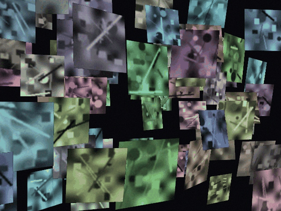
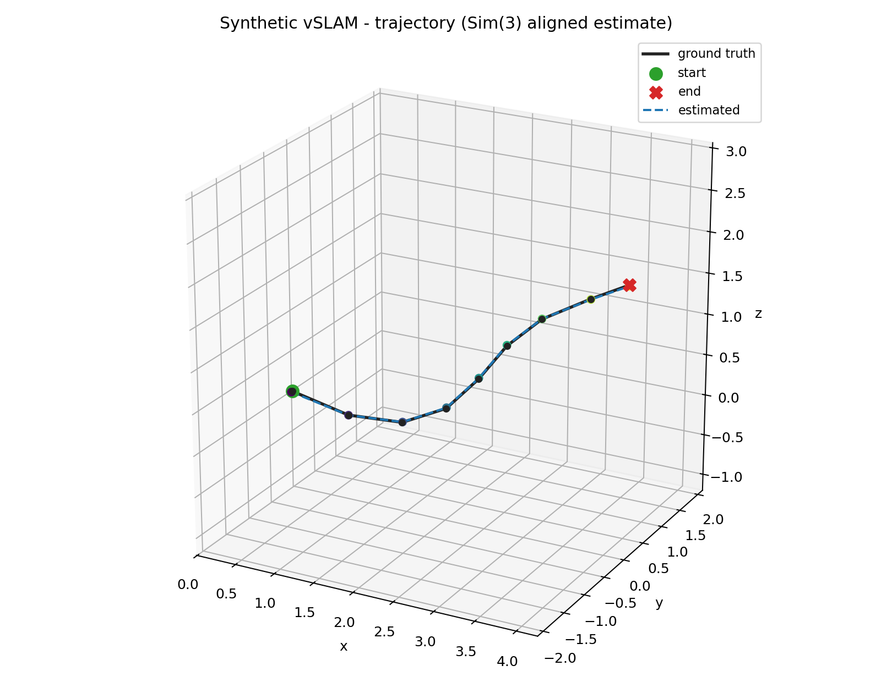
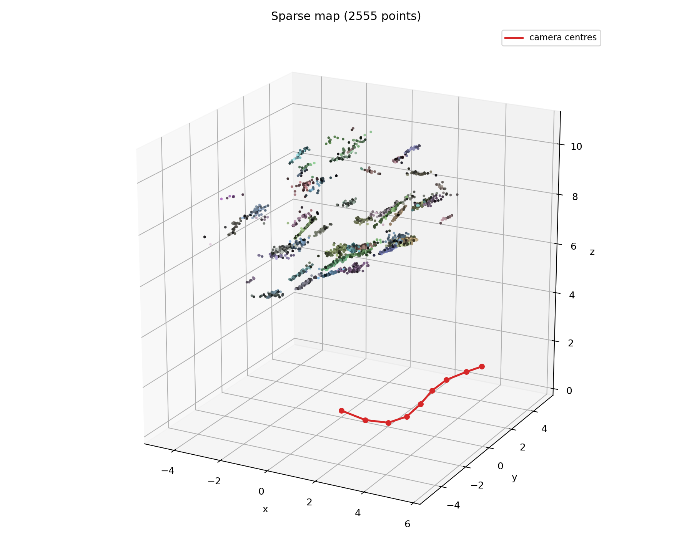
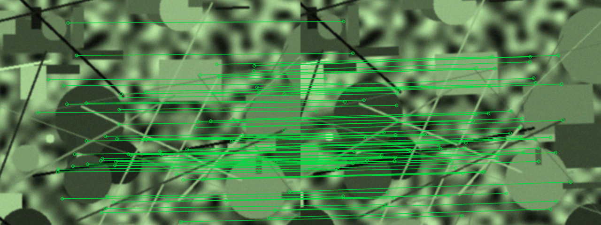
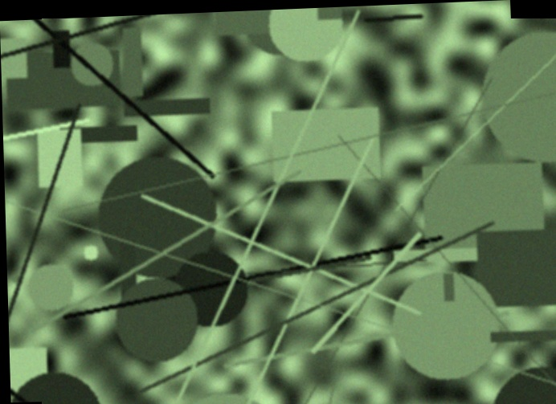

# vSLAM Fundamentals

A compact, readable **monocular visual SLAM** pipeline in Python. It estimates
camera motion and builds a sparse coloured 3D map from an ordered image
sequence, using classical multi-view geometry and an optional learned feature
front-end.

The repository is deliberately small: every stage is implemented in a few
well-named functions, the coordinate conventions are documented, and a
self-contained synthetic simulator makes the whole pipeline reproducible
without a robot, a game engine, or an external dataset.



---

## What it does

Given a calibrated camera and a sequence of images, the pipeline:

1. selects keyframes with enough image motion,
2. detects and matches features (SIFT + ratio test by default),
3. estimates the fundamental matrix with RANSAC,
4. converts it to an essential matrix and recovers relative pose,
5. triangulates 3D points,
6. localises each new keyframe with PnP against the existing map,
7. adds newly observed points and refines poses/points with an alternating
   bundle-adjustment pass,
8. exports the trajectory and a static 3D map plot.

In a robotics stack this is the **visual perception front-end**: the estimated
camera trajectory is the localisation signal, and the sparse map is the
landmark set a robot can navigate against. The code is robot-agnostic — it
contains no simulator bridge, middleware, vendor SDK, or robot model.

### Pipeline

```text
ordered images
      │
      ▼
optical-flow keyframe selection
      │
      ▼
SIFT / SuperPoint features  ──►  ratio / SuperGlue matching
      │
      ▼
F RANSAC  ──►  E = Kᵀ F K  ──►  recoverPose (cheirality)
      │
      ▼
triangulation  ──►  sparse map
      │
      ▼
PnP localisation of each new keyframe
      │
      ▼
new points + alternating bundle adjustment
      │
      ▼
trajectory.csv + 3D map
```

---

## Demo

The synthetic demo renders a textured 3D scene, runs the complete pipeline,
and evaluates the estimate against exact ground truth.

```bash
python -m venv .venv
# Windows
.venv\Scripts\activate
# Linux / macOS
# source .venv/bin/activate

pip install -r requirements.txt
python scripts/run_synthetic_slam.py
```

Outputs are written to `runs/synthetic/`:

| File | Content |
|---|---|
| `trajectory.png` | ground truth vs. Sim(3)-aligned estimate |
| `map.png` | sparse coloured point cloud + camera centres |
| `matches.png` | RANSAC inlier matches between the first two keyframes |
| `trajectory_estimated.csv` | estimated camera poses |
| `metrics.json` | ATE, RPE and runtime |
| `dataset/` | rendered images + ground-truth poses |

### Result on the default scene

| Metric | Value |
|---|---|
| Keyframes | 9 (from 24 frames) |
| Map points | 2,555 |
| ATE RMSE after Sim(3) alignment | **0.0096** |
| Rotation RPE (mean) | **0.058°** |
| Translation RPE (mean) | **0.0070** |
| RMS reprojection error | **0.29 px** |
| Runtime (CPU, SIFT, 640×480) | **≈ 6 s** |

These numbers are for the synthetic scene and are meant to demonstrate that
the geometry is correct, not to claim state-of-the-art accuracy. Monocular
scale is unobservable; the estimate is aligned to ground truth with Umeyama's
Sim(3) solution before ATE is computed.

| Trajectory | Sparse map |
|---|---|
|  |  |

---

## Planar homography demo

The same feature layer also supports the planar case. This demo renders two
views of a textured wall, estimates a homography with RANSAC, and builds a
small mosaic.

```bash
python scripts/run_homography_demo.py
```

| Inlier matches | Mosaic |
|---|---|
|  |  |

---

## Run on your own images

The camera must be calibrated. Pass the intrinsics explicitly; distortion
coefficients are optional.

```bash
python scripts/run_sequence.py \
  --images path/to/frames \
  --fx 641.84 --fy 641.17 --cx 311.14 --cy 244.66 \
  --dist -0.0233 0.2523 0 0 -0.5219 \
  --output runs/my_sequence
```

Images are sorted by filename and can be `.jpg`, `.png`, `.bmp` or `.tif`.
The output is a trajectory CSV, a 3D map plot and console statistics. There
is no ground truth in this mode, so no accuracy metrics are printed.

Useful options:

| Option | Effect |
|---|---|
| `--keyframe-threshold` | accumulated optical flow needed for a new keyframe |
| `--max-keyframes` | upper bound on the number of keyframes |
| `--max-depth` | discard triangulations beyond this depth |
| `--max-reproj` | reprojection-error gate in pixels |
| `--no-refine` | skip bundle adjustment for a faster, rougher result |

---

## Optional learned front-end

The default SIFT back-end has no heavy dependencies and runs on CPU. For
difficult lighting or wide viewpoint changes, the public SuperPoint +
SuperGlue networks can be used instead:

```bash
git clone https://github.com/magicleap/SuperGluePretrainedNetwork \
  third_party/SuperGluePretrainedNetwork
pip install torch

python scripts/run_synthetic_slam.py --matcher superglue
```

The third-party repository and its weights are **not** vendored here; they
remain under their own licence. The adapter lives in
`vslam/features.py` and follows the same `detect` / `match` interface as the
SIFT back-end.

---

## How it works

The short version is in the pipeline diagram above. The full derivation,
coordinate conventions, parameter meanings and failure modes are in
[docs/how_it_works.md](docs/how_it_works.md). The simulator and the evaluation
protocol are described in [docs/simulation.md](docs/simulation.md).

A few conventions worth knowing before reading the code:

- Camera coordinates are OpenCV-style: `x` right, `y` down, `z` forward.
- `T_cw` maps **world → camera**; it is what PnP returns.
- `T_wc` maps **camera → world**; it is the camera pose and the inverse of
  `T_cw`.
- The first keyframe defines the world frame, so its pose is the identity.
- Monocular reconstruction is defined only up to scale.

---

## Repository layout

```text
vslam/
  camera.py          pinhole camera, projection, undistortion
  features.py        SIFT and optional SuperPoint/SuperGlue back-ends
  geometry.py        F, E, relative pose, triangulation, PnP
  homography.py      planar H estimation and mosaic warping
  keyframes.py       optical-flow keyframe selection
  pipeline.py        incremental SLAM + alternating bundle adjustment
  simulation.py      textured 3D scene, camera path, renderer, ground truth
  evaluate.py        Umeyama Sim(3) alignment, ATE / RPE
  visualization.py   3D plots, match sheets, trajectory CSV

scripts/
  run_synthetic_slam.py   full demo with ground-truth metrics
  run_sequence.py         run on an arbitrary calibrated image folder
  run_homography_demo.py  planar homography + mosaic demo

tests/
  test_geometry.py        triangulation, F/E/pose, PnP, H, Sim(3)

docs/
  how_it_works.md
  simulation.md
  images/
```

---

## Limitations

This is a teaching and portfolio implementation, not a production SLAM
system. In particular it does **not** implement:

- loop closure or global pose-graph optimisation,
- relocalisation after tracking loss,
- IMU / wheel / LiDAR fusion,
- dense or semi-dense mapping,
- rolling-shutter or motion-blur modelling,
- automatic camera calibration.

Drift therefore accumulates over long sequences. The map is sparse and the
bundle adjustment is a lightweight alternating scheme rather than a full
sparse Levenberg–Marquardt solver. On the synthetic demo the error is small
because the scene, the camera model and the feature matches are clean; real
sequences will be harder.

---

## References

- R. Hartley and A. Zisserman, *Multiple View Geometry in Computer Vision*,
  Cambridge University Press, 2003.
- D. G. Lowe, "Distinctive Image Features from Scale-Invariant Keypoints",
  *IJCV*, 2004.
- D. DeTone, T. Malisiewicz and A. Rabinovich, "SuperPoint: Self-Supervised
  Interest Point Detection and Description", *CVPR Workshops*, 2018.
- P.-E. Sarlin, D. DeTone, T. Malisiewicz and A. Rabinovich, "SuperGlue:
  Learning Feature Matching with Graph Neural Networks", *CVPR*, 2020.
- S. Umeyama, "Least-squares estimation of transformation parameters between
  two point patterns", *IEEE TPAMI*, 1991.

---

## Licence

MIT. See [LICENSE](LICENSE). The optional SuperPoint/SuperGlue code and
weights are external and are not covered by this licence.
