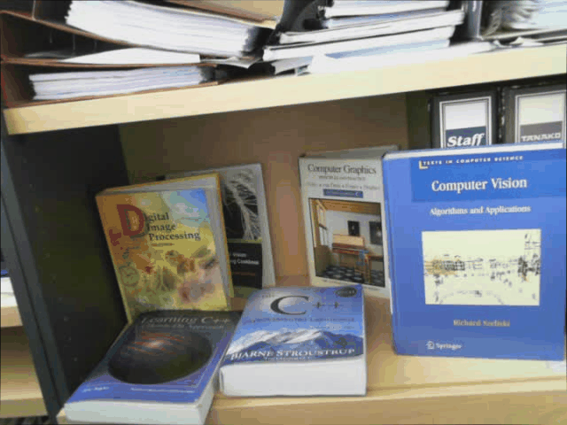
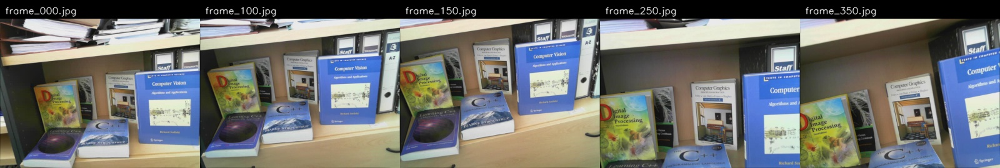
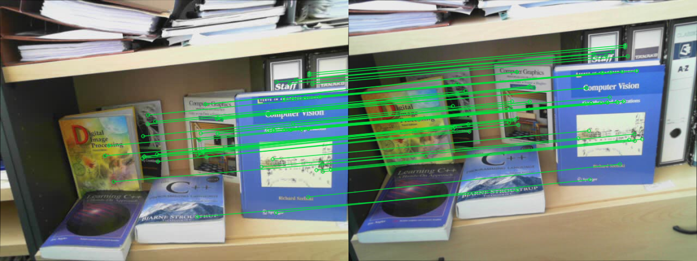
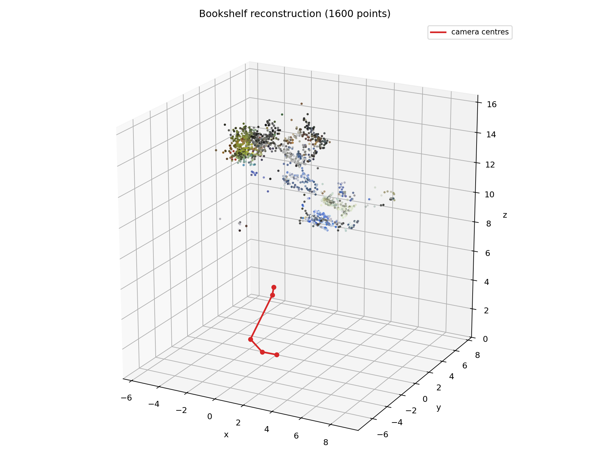
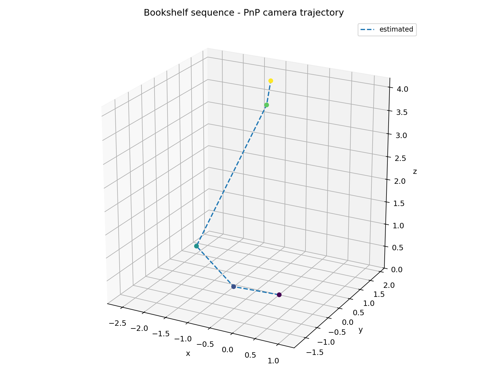
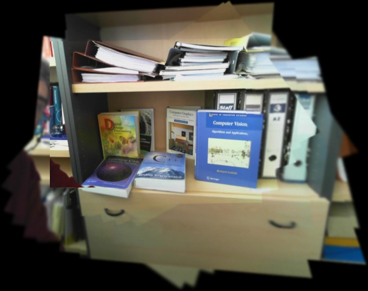

# vSLAM Fundamentals

### Incremental 3D reconstruction and camera localisation with PnP


A compact Python implementation of a visual reconstruction pipeline: from a
calibrated image sequence it builds a sparse coloured 3D map and estimates the
pose of every new keyframe with **PnP against the map already reconstructed**.

The project is built around the incremental structure-from-motion loop:

```text
keyframes → feature matches → epipolar geometry → initial triangulation
          → for each new keyframe:
                PnP against the current 3D map
                triangulate the matches that have no 3D point yet
                add the new points to the map
          → optional bundle-adjustment refinement
          → camera trajectory + coloured point cloud
```



---

## What it does

Given a calibrated camera and an ordered set of frames, the pipeline:

1. selects keyframes with enough image motion,
2. detects and matches features (SIFT + ratio test by default),
3. estimates the fundamental matrix with RANSAC,
4. converts it to an essential matrix and recovers the initial relative pose,
5. triangulates the first set of 3D points,
6. **localises every new keyframe with PnP** against the existing 3D points,
7. **triangulates matches without a 3D point** using the two most recent
   camera poses and adds them to the map,
8. optionally refines poses/points with an alternating bundle-adjustment pass,
9. exports the trajectory and a static 3D map plot.

In a robotics stack this is the visual perception front-end: the estimated
camera trajectory is the localisation signal, and the sparse map is the
landmark set used for navigation. The code is robot-agnostic — it contains no
simulator bridge, middleware, vendor SDK, or robot model.

---

## Real-data result: bookshelf reconstruction

The example uses five real keyframes from a handheld pan across a bookshelf,
with the camera calibrated at `fx ≈ 641.8`, `fy ≈ 641.2`, `cx ≈ 311.1`,
`cy ≈ 244.7`. The five frames and the calibration are included in
[`examples/bookshelf/`](examples/bookshelf/).

| Input keyframes |
|---|
|  |

| SIFT matches (RANSAC inliers) | Reconstructed map |
|---|---|
|  |  |

| PnP camera trajectory |
|---|
|  |

| Metric | Value |
|---|---:|
| Keyframes | 5 |
| Reconstructed map points | **1,600** |
| RMS reprojection error | **0.38 px** |
| Runtime (CPU, SIFT, 640×480) | **≈ 1.8 s** |
| Ground truth | not available for this sequence |

The map is sparse and the reconstruction is monocular, so its scale is
arbitrary. The point cloud is coloured with the pixels of the reference
frames; the red line joins the five estimated camera centres.

### Reproduce it

```bash
python -m venv .venv
# Windows
.venv\Scripts\activate
# Linux / macOS
# source .venv/bin/activate

pip install -r requirements.txt
python scripts/run_bookshelf_demo.py
```

Outputs are written to `runs/bookshelf/`:

| File | Content |
|---|---|
| `map.png` | coloured 3D point cloud + camera centres |
| `trajectory.png` | estimated camera trajectory |
| `matches.png` | RANSAC inlier matches between the first two frames |
| `input_montage.jpg` | the five input keyframes |
| `input_sequence.gif` | animated input sequence |
| `trajectory_estimated.csv` | estimated camera poses |
| `metrics.json` | map size, reprojection error and runtime |

The demo undistorts every image with the supplied calibration before feature
detection, so the pinhole geometry used by triangulation and PnP is exact.

---

## Planar homography

The repository also includes the planar part of the pipeline: homography
estimation with RANSAC and mosaic warping. `scripts/run_homography_demo.py`
runs a self-contained test on a synthetic textured wall.

The image below is a mosaic obtained from the bookshelf scene by the original
prototype:



---

## Run on your own images

The camera must be calibrated. Pass the intrinsics explicitly; distortion
coefficients are optional. Images are undistorted automatically before the
geometry stage.

```bash
python scripts/run_sequence.py \
  --images path/to/frames \
  --fx 641.84 --fy 641.17 --cx 311.14 --cy 244.66 \
  --dist -0.0233 0.2523 0 0 -0.5219 \
  --output runs/my_sequence
```

Images are sorted by filename and can be `.jpg`, `.png`, `.bmp` or `.tif`.
The output is a trajectory CSV, a 3D map plot and console statistics. There
is no ground truth in this mode, so no accuracy metrics are printed.

Useful options:

| Option | Effect |
|---|---|
| `--keyframe-threshold` | accumulated optical flow needed for a new keyframe |
| `--max-keyframes` | upper bound on the number of keyframes |
| `--max-depth` | discard triangulations beyond this depth |
| `--max-reproj` | reprojection-error gate in pixels |
| `--no-refine` | skip bundle adjustment for a faster, rougher result |

---

## Optional learned front-end

The default SIFT back-end has no heavy dependencies and runs on CPU. For
difficult lighting or wide viewpoint changes, the public SuperPoint +
SuperGlue networks can be used instead:

```bash
git clone https://github.com/magicleap/SuperGluePretrainedNetwork \
  third_party/SuperGluePretrainedNetwork
pip install torch

python scripts/run_bookshelf_demo.py --matcher superglue
```

The third-party repository and its weights are **not** vendored here; they
remain under their own licence. The adapter lives in
`vslam/features.py` and follows the same `detect` / `match` interface as the
SIFT back-end.

---

## How it works

The full derivation, coordinate conventions, parameter meanings and failure
modes are in [docs/how_it_works.md](docs/how_it_works.md). The short version:

- **PnP** solves for the new camera pose from 3D points already in the map
  and their 2D observations in the new keyframe.
- **Triangulation** creates new 3D points from matches that do not yet have a
  map point, using the previous and current camera poses.
- The two steps alternate, so the map grows as the camera moves.

A few conventions worth knowing before reading the code:

- Camera coordinates are OpenCV-style: `x` right, `y` down, `z` forward.
- `T_cw` maps **world → camera**; it is what PnP returns.
- `T_wc` maps **camera → world**; it is the camera pose and the inverse of
  `T_cw`.
- The first keyframe defines the world frame, so its pose is the identity.
- Monocular reconstruction is defined only up to scale.

---

## Synthetic regression test

A deterministic synthetic renderer is included for unit and integration tests.
It is **not** the project data and it is not the main demo: it provides exact
ground truth so the geometry can be checked automatically.

```bash
python scripts/run_synthetic_slam.py
python -m unittest discover -s tests -v
```

On the default synthetic scene the pipeline reports ATE RMSE `0.0096`,
rotation RPE `0.058°` and RMS reprojection error `0.29 px` after Sim(3)
alignment. All five geometry tests pass. This is a correctness check, not a
benchmark against the state of the art.

---

## Repository layout

```text
vslam/
  camera.py          pinhole camera, projection, undistortion
  features.py        SIFT and optional SuperPoint/SuperGlue back-ends
  geometry.py        F, E, relative pose, triangulation, PnP
  homography.py      planar H estimation and mosaic warping
  keyframes.py       optical-flow keyframe selection
  pipeline.py        incremental PnP + triangulation, optional BA
  simulation.py      synthetic regression scene and ground truth
  evaluate.py        Umeyama Sim(3) alignment, ATE / RPE
  visualization.py   3D plots, match sheets, trajectory CSV

scripts/
  run_bookshelf_demo.py   real-data reconstruction demo
  run_sequence.py         run on an arbitrary calibrated image folder
  run_synthetic_slam.py   deterministic regression demo with metrics
  run_homography_demo.py  planar homography test

examples/
  bookshelf/              five real frames + camera calibration

tests/
  test_geometry.py        triangulation, F/E/pose, PnP, H, Sim(3)

docs/
  how_it_works.md
  simulation.md
  images/
```

---

## Limitations

This is a compact reconstruction implementation, not a production SLAM
system. In particular it does **not** implement:

- loop closure or global pose-graph optimisation,
- relocalisation after tracking loss,
- IMU / wheel / LiDAR fusion,
- dense or semi-dense mapping,
- rolling-shutter or motion-blur modelling,
- automatic camera calibration.

Drift therefore accumulates over long sequences. The map is sparse and the
bundle adjustment is a lightweight alternating scheme rather than a full
sparse Levenberg–Marquardt solver. The bookshelf sequence is close to planar
and the camera motion is mostly a pan, which is a harder case for epipolar
geometry; the result is a qualitative reconstruction, not a metric evaluation.

---

## References

- R. Hartley and A. Zisserman, *Multiple View Geometry in Computer Vision*,
  Cambridge University Press, 2003.
- D. G. Lowe, "Distinctive Image Features from Scale-Invariant Keypoints",
  *IJCV*, 2004.
- D. DeTone, T. Malisiewicz and A. Rabinovich, "SuperPoint: Self-Supervised
  Interest Point Detection and Description", *CVPR Workshops*, 2018.
- P.-E. Sarlin, D. DeTone, T. Malisiewicz and A. Rabinovich, "SuperGlue:
  Learning Feature Matching with Graph Neural Networks", *CVPR*, 2020.
- S. Umeyama, "Least-squares estimation of transformation parameters between
  two point patterns", *IEEE TPAMI*, 1991.

---

## Licence

MIT. See [LICENSE](LICENSE). The optional SuperPoint/SuperGlue code and
weights are external and are not covered by this licence.
